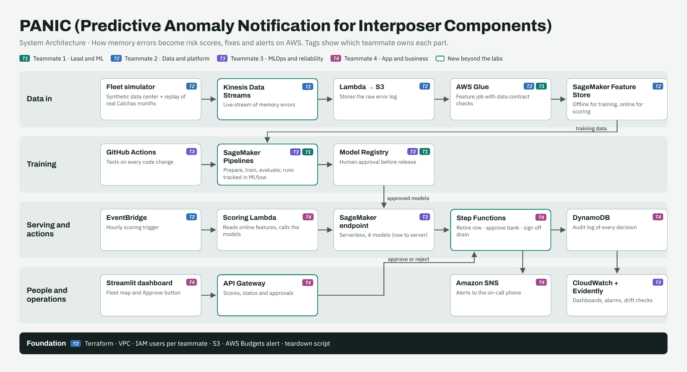
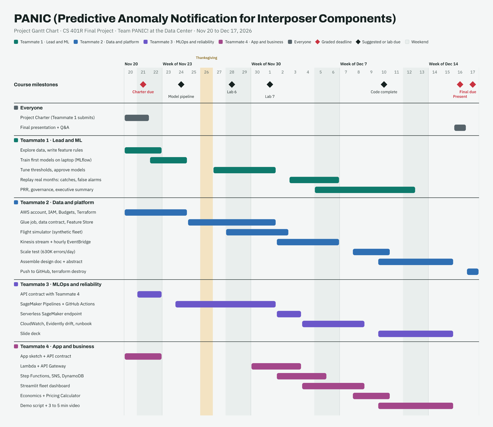

# Panic Project Charter  
Joe Gerard, Tom Esplin, Caden Annison, RJ Gammoh

***Project Charter:***

  - > **Project Title:** PANIC
    
      - > Predictive Anomaly Notification for Interposer Components
        
          - > **Interposer** is a high-density electrical interface layer—most commonly made of silicon, organic substrate, or glass—that sits between multiple microchips (chiplets) and the main package substrate or printed circuit board (PCB).
        
          - > In advanced semiconductor packaging (specifically **2.5D and 3D IC integration**), an interposer acts as a microscopic "bridge" or high-speed highway that allows separate dies—such as a GPU/CPU compute die and High Bandwidth Memory (HBM) stacks—to communicate at ultra-high speeds with minimal power loss.

  - > **Project Vision:** What is the problem? What is the goal? Why is this important?
    
      - > During intense AI training jobs High Bandwidth Memory (HBM) failures can cause the training jobs to crash, potentially costing businesses thousands of dollars. The goal is to use HBM error logs to predict memory failures before they crash jobs, saving companies money and wasted time. This is important because not only can it save money, but crashed jobs are often required to re-run, which can use valuable resources like runtime, water and electricity.

  - > **Group Members' Roles and Responsibilities:** List each member and their role for the project. This can change/flex during the project.
    
      - > Tom Esplin - Data and Platform
    
      - > RJ Gammoh - Lead and ML
    
      - > Caden Annison - MLOps and Reliability
    
      - > Joe Gerard - App and Business

  - > **Values, Commitments, Communication:** What values are important for this project's success? How will you hold each other accountable? How will you communicate and track progress?
    
      - > Values: Independence, hardwork, accountability, ownership
    
      - > We’ll hold each other accountable by holding a weekly a standup meeting
    
      - > We’ll communicate progress via discord and during our weekly standups. We’ll track progress via the Gantt chart.

  - > Project Architecture and Description: A high-level architecture diagram and description showing the major components of the system.

  - > Project Plan with Gantt Chart and Milestones

